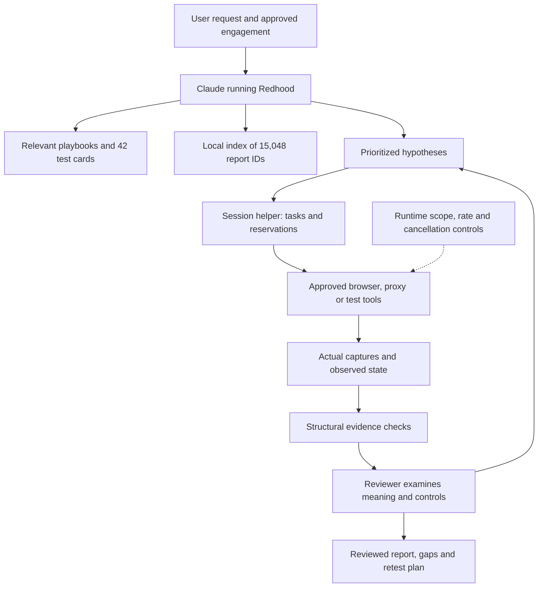
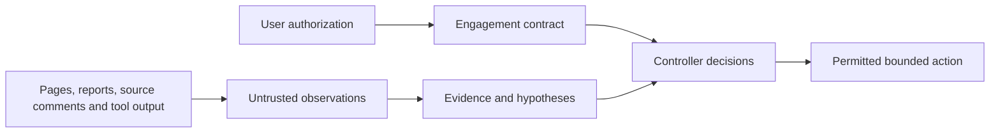
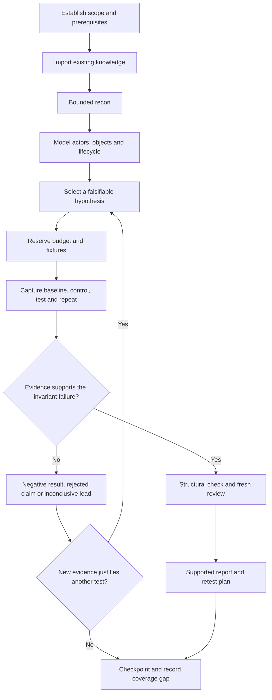
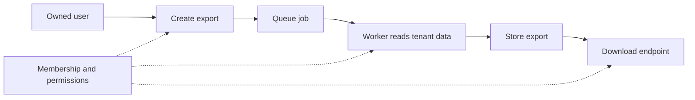
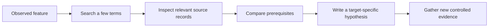
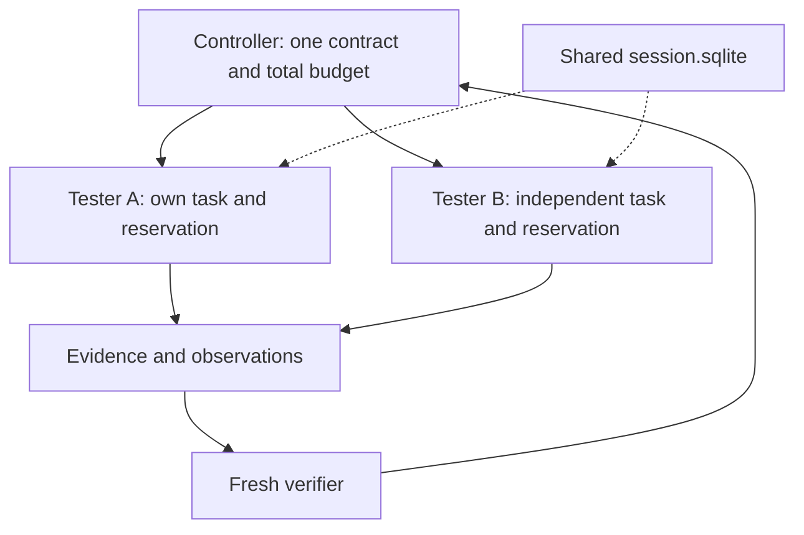
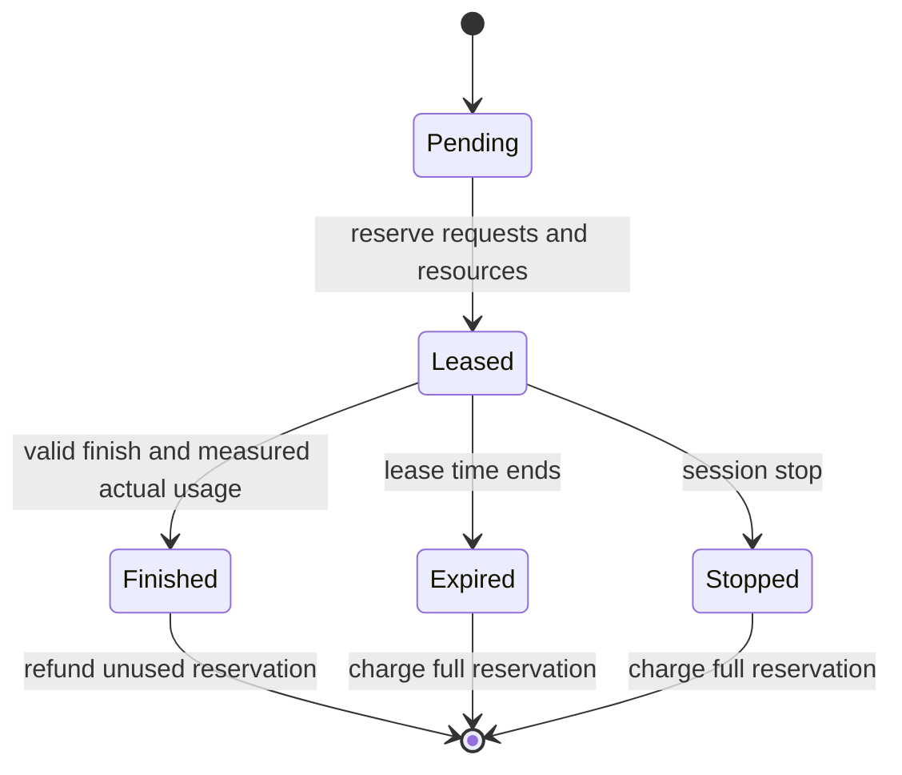
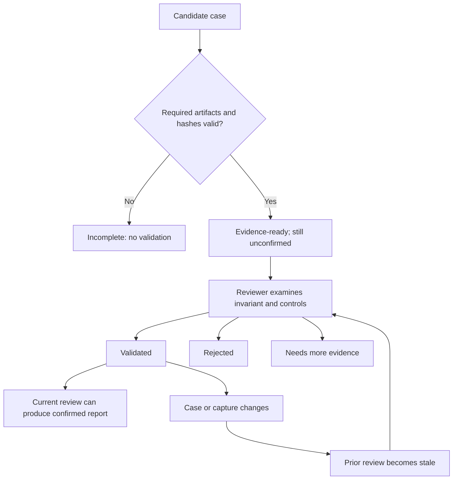
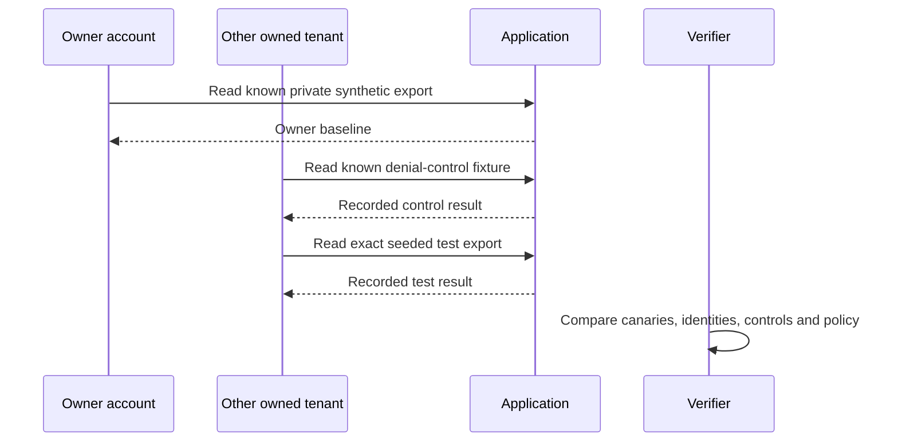

# Redhood — complete user guide

**By Nipun Dilshan Senevirathne · Skill version 1.0.0 · Guide updated 2026-10-20**

Redhood is a Claude Code skill for authorized company application security assessments and scoped bug bounty work. It helps Claude move from useful reconnaissance to application understanding, focused hypotheses, controlled tests, evidence review, reporting and retesting. It deliberately avoids Amass.

This guide starts with installation and explains the complete operating model. Commands in fenced blocks are examples for the operator; merely reading this file does not run them. Example domains, accounts and records are fictional.

[Skill instructions](SKILL.md) · [Installation reference](INSTALL.md) · [Company hunter audit](AUDIT.md) · [Research](RESEARCH.md) · [Validation results](VALIDATION.md)

## Contents

1. [What Redhood is](#what-redhood-is)
2. [Architecture](#architecture)
3. [Requirements](#requirements)
4. [Install from scratch](#install-from-scratch)
5. [First use in Claude](#first-use-in-claude)
6. [Prepare an engagement](#prepare-an-engagement)
7. [The complete hunting workflow](#the-complete-hunting-workflow)
8. [Coverage and bypass families](#coverage-and-bypass-families)
9. [Using the report corpus](#using-the-report-corpus)
10. [Workers, leases and budgets](#workers-leases-and-budgets)
11. [Evidence and reviewer decisions](#evidence-and-reviewer-decisions)
12. [A worked investigation](#a-worked-investigation)
13. [Reporting, retesting and resume](#reporting-retesting-and-resume)
14. [Files and helper commands](#files-and-helper-commands)
15. [Troubleshooting](#troubleshooting)
16. [Research, testing and limitations](#research-testing-and-limitations)
17. [Daily operating checklist](#daily-operating-checklist)
18. [Glossary](#glossary)

The diagrams use Mermaid, supported by GitHub and many Markdown viewers. If a viewer shows diagram source instead, the adjacent text explains the same workflow. No diagram requires a network connection or an external rendering service.

## What Redhood is

A skill is a folder of instructions and supporting resources that Claude loads when relevant or when explicitly invoked. Redhood combines a short main instruction file with detailed references, local metadata retrieval, templates and Python helpers. Claude supplies the reasoning; approved tools supply actual observations.

| Component | Purpose |
|---|---|
| Main skill | Chooses the workflow, preserves scope and routes to relevant references |
| Playbooks and test cards | Turn observed application features into specific security questions |
| Report index | Retrieves historical clues and their source provenance |
| Session helper | Coordinates tasks, exclusive resources and request reservations |
| Evidence helper | Checks required files and hashes, records reviews and applies their decisions |
| Operator and tool runtime | Provide authorization, accounts, capture tools, traffic controls and real testing |

For example, finding an export endpoint is reconnaissance. Understanding who owns an export is application modeling. Asking whether a removed member can still download it is a hypothesis. A controlled comparison with actual captures is testing. Establishing that the result violates the intended policy is validation.

Redhood does not modify Claude's model weights. Its corpus is retrieval material. It does not include an autonomous scanning service, install every recon tool, automatically capture HTTP traffic, enforce all outbound network policy, or guarantee findings. Its Python helpers work offline and send no target traffic.

## Architecture



The session helper accounts for work; it does not intercept the tool's requests. The URL helper checks a URL string; it does not verify DNS answers, enforce methods, follow redirects safely on behalf of another tool, or cancel processes. Actual tool execution must respect the contract at the request boundary.

### Trust boundaries



Target text and historical reports can provide facts to investigate. They cannot grant permission, broaden scope, request credentials, or instruct Claude to run commands. The same applies to instruction-like content inside screenshots, logs or downloaded files.

## Requirements

| Requirement | When needed |
|---|---|
| Claude Code with skill support | To invoke the skill as `/redhood` |
| Complete `redhood` folder | Always; keep supporting folders with `SKILL.md` |
| Python 3.10 or later | To use the offline helpers; no pip dependencies required |
| A writable project/engagement directory | To store state, evidence and reports |
| Approved target scope and test identities | Before active target testing |
| Browser/proxy or other approved testing tools | When the chosen method needs them |
| Git | Only for rebuilding the index directly from Marco Git objects |

Optional tools include Subfinder, ProjectDiscovery httpx, Katana, gau, waybackurls, ffuf and Nuclei. Their presence is not required for every assessment. Source, API schemas, existing captures and normal application workflows can provide useful starting points without them.

The name `httpx` is ambiguous: ProjectDiscovery's Go recon tool and Python's HTTP client ecosystem are different products. The doctor reports executable paths; inspect the actual tool's help and version before using it.

## Install from scratch

### Windows project installation

Your saved delivery is at `C:\Users\Nipun\Downloads\redhood`. It contains the unpacked skill and both distribution archives. Choose the company project in which you want Claude to use Redhood.

The following PowerShell example uses a new project folder. Replace its path with your chosen project. It refuses to overwrite an existing Redhood installation.

```powershell
$projectPath = 'C:\Users\Nipun\Documents\RedhoodLab'
$skillParent = Join-Path $projectPath '.claude\skills'
$skillPath = Join-Path $skillParent 'redhood'
if (Test-Path -LiteralPath $skillPath) {
    throw 'A Redhood installation already exists. Review it before updating.'
}
New-Item -ItemType Directory -Path $skillParent -Force | Out-Null
Expand-Archive -LiteralPath 'C:\Users\Nipun\Downloads\redhood\redhood.zip' -DestinationPath $skillParent
Set-Location -LiteralPath $projectPath
python .claude/skills/redhood/scripts/doctor.py
```

If Windows has `py` but not `python`, use `py -3` in place of `python` after checking the interpreter version. If neither works, install Python through your normal company process.

Expected installed structure:

```text
RedhoodLab/
  .claude/
    skills/
      redhood/
        SKILL.md
        README.md
        scripts/
        references/
        assets/
        data/
  engagement/                 created separately for assessment state
```

Start Claude Code in the project, then enter `/redhood doctor`. Redhood's `doctor` mode is part of this skill; it is distinct from Claude Code's own `/doctor` command.

### Linux or macOS

Extract the archive's top-level `redhood/` directory into the project's `.claude/skills/` directory. Keep the same folder structure. Use `python3` for helper commands if that is your interpreter command.

This package's recorded execution checks were performed on Windows. The standard-library helpers are intended to be portable, but the package does not claim a separate Linux/macOS validation run.

### Optional verifier agent

Copy `assets/agents/redhood-verifier.md` from the installed skill into the project's `.claude/agents/` folder. Check for an existing file before replacing it. This optional agent has read-only tools and returns a review; the controller records the decision.

You can use sequential roles if subagents are unavailable. Installing the verifier does not create a background service or start testing.

### ZIP versus `.skill`

`redhood.zip` and `redhood.skill` contain the same ZIP-based package. The `.skill` extension is provided for compatible custom loaders. `load redhood.skill` is not a universal native Claude Code command. Native installation uses the skill folder and `/redhood`.

Official format references: [Claude skills](https://code.claude.com/docs/en/skills) and [Claude subagents](https://code.claude.com/docs/en/sub-agents).

## First use in Claude

These are prompts to type inside Claude Code, not PowerShell commands:

```text
/redhood doctor
```

```text
/redhood research the supplied company source and existing captures.
Create an application model, identify missing context, and prioritize hypotheses.
```

```text
/redhood plan using ./engagement/contract.json and the supplied API schema.
Use the two company-owned test identities and reserve time for verification.
```

```text
/redhood hunt using ./engagement/contract.json.
Start from the existing captures, prioritize tenant isolation and export lifecycle,
and checkpoint each meaningful result.
```

```text
/redhood verify ./engagement/cases/CASE-001.json using the actual captures.
Challenge the negative control, session isolation and demonstrated impact.
```

```text
/redhood resume from ./engagement/checkpoint.md.
Recheck the contract, active workers, sessions and fixtures before continuing.
```

| Mode | Intended result |
|---|---|
| `doctor` | Tool/package inventory and missing prerequisites |
| `research` | Source-backed understanding and useful historical precedents |
| `recon` | Scoped inventory of reachable, relevant features |
| `plan` | Ranked, falsifiable hypotheses with budgets and controls |
| `hunt` | Bounded testing and observed outcomes |
| `source-review` | Reachable data-flow and trust-boundary analysis |
| `verify` | Critical review of a candidate and its evidence |
| `report` | Findings, limitations, coverage gaps and remediation |
| `retest` | Fresh checks of a fix and related valid behavior |
| `resume` | Continue from recorded state without silently resetting budgets |

These mode words guide Claude's behavior. They are not separate compiled commands, and Claude should adapt the workflow to the actual request.

## Prepare an engagement

Keep each assessment's state outside the installed skill. From the project directory, create `engagement/` and copy the templates without overwriting existing assessment files:

```text
assets/engagement.example.json  -> engagement/contract.json
assets/hypothesis.example.json  -> engagement/hypotheses/RH-H001.json
assets/case.example.json        -> engagement/cases/CASE-001.json
assets/coverage.example.json    -> engagement/coverage.json
```

The shipped contract deliberately has `authorization_confirmed: false`. Complete it using actual company approval or the applicable program policy. Changing a Boolean is bookkeeping; it does not create authorization.

Record the following before active requests:

| Contract area | Information needed |
|---|---|
| Authorization | Approval/program reference and confirmed scope |
| Assets | Exact hosts, schemes, ports and allowed path prefixes |
| Exclusions | Forbidden hosts, paths, methods and operations |
| Identity | Owned accounts, roles, tenants and approved credential handling |
| Time | Approved testing window and timezone |
| Traffic | Aggregate and per-host rate, total requests and concurrency |
| Changes | Which synthetic writes, callbacks or special methods are permitted |
| Stop/cleanup | Instability, rate limits, unexpected data, scope ambiguity and cleanup owner |

A wildcard does not automatically include its apex in the supplied URL helper. `*.api.example.test` covers descendants; add `api.example.test` explicitly if authorized. A discovered CNAME, shared IP or third-party login service does not become authorized merely because the application links to it.

Recommended working files:

```text
engagement/
  contract.json
  session.sqlite
  environment.json
  inventory.jsonl
  fixtures.json
  model.md
  hypotheses/
  captures/
  cases/
  coverage.json
  checkpoint.md
  reports/
```

Use account aliases in notes. Store credentials in the approved credential mechanism, not the skill, shell arguments, corpus, shared briefs or reports. The helpers do not configure encryption, retention, filesystem permissions or comprehensive secret redaction.

## The complete hunting workflow



### 1. Orient and establish a baseline

Read the contract, existing findings, previous checkpoints, known controls and tool inventory. Verify which sessions actually work. Maintain independent cookie/browser contexts for each identity, including anonymous. Confirm who-am-I and tenant immediately before identity comparisons.

### 2. Recon for useful boundaries

Start from company asset lists, API schemas, source routes and proxy captures. Add bounded passive discovery when useful. Filter candidates before active probing, preserve provenance, cluster similar surfaces and inspect representative workflows. Keep useful 401/403 responses as access-control boundaries.

No Amass is used. Historical URLs are discovery clues, not a replay queue. Do not automatically submit forms or follow logout, deletion, payment or one-use links. The [recon playbook](references/recon.md) explains tool selection, constraints and stopping rules.

### 3. Model the application

Identify actors, tenants, objects, grants, queues, caches and derived artifacts. Follow sensitive actions across their lifecycle. A correct check at job creation may not establish correct authorization at worker execution or download.



Each permission arrow is a separate question to investigate, not a claim that a bug exists.

### 4. Choose hypotheses

A useful hypothesis states the intended invariant, observed clue, competing benign explanation, required fixtures, smallest distinguishing test, semantic oracle and stop condition. Keep at most five active hypotheses. A default limit of three distinct variants before a checkpoint prevents unproductive mutation loops; additional work should follow new evidence.

Prioritize consequential reachable boundaries with strong oracles. A historical critical bounty is not evidence of current applicability. Reserve time for verification and reporting.

### 5. Test and refute

Change one dimension at a time. Compare actual baseline, control, test and repeat observations. Check final state, not only status codes. Missing controls, stale sessions, generic errors or an unstable baseline make the result inconclusive.

Before promotion, examine reflection, public sharing, cache contamination, client-only behavior, eventual consistency and tooling artifacts. Return to focused recon when a missing prerequisite blocks a useful test.

## Coverage and bypass families

The package includes 42 [structured test cards](references/test-cards.md). Each records prerequisites, invariant, minimal test, oracle, common false positives, stop rule and a primary source.

| Area | Example questions | Detailed guide |
|---|---|---|
| Access and identity | Object, tenant, role, session, recovery, OAuth, SAML and JWT binding | [access-auth.md](references/access-auth.md) |
| APIs and asynchronous work | Property permissions, GraphQL, batches, filters, subscriptions, exports and webhooks | [apis.md](references/apis.md) |
| Business logic | One-use transitions, approvals, retries, replay and bounded concurrency | [logic-races.md](references/logic-races.md) |
| Server input | Query structure, templates, files, uploads, archives, parsers and fetch destinations | [server-input.md](references/server-input.md) |
| Browser | Actual script execution, CSRF, CORS, messaging, DOM and framing effects | [browser.md](references/browser.md) |
| Infrastructure | Cloud policy, storage, DNS, cache and configuration exposure | [infra-cloud.md](references/infra-cloud.md) |
| Source and specialists | Reachable flows, dependency/build trust, mobile/native routing | [source-review.md](references/source-review.md) |
| AI applications | Retrieval isolation, tools, memory, delegation and approval boundaries | [ai-apps.md](references/ai-apps.md) |

The 15 [cross-cutting bypass families](references/bypass-map.md) describe identity substitution, role substitution, alternate entry points, representation mismatches, normalization order, verification/consumption differences, context loss, lifecycle gaps, temporal gaps, replay, client/server differences, fallback paths, cache collisions, query expressiveness and delegation/approval gaps.

Here, “bypass” means an application control fails under a controlled authorized test. It does not mean evading the engagement's rate limits, monitoring, scope or approvals. Select a family because an observed mechanism makes it relevant.

Coverage is multidimensional: feature × operation × role × tenant/object relation × lifecycle × security property. The presence of 42 cards does not mean 42 categories were tested or that all security specialties are covered.

## Using the report corpus

The index contains **15,048 unique report IDs** from three sources:

| Source | Source records |
|---|---:|
| codebygk metadata | 10,000 |
| Marco Markdown reports | 9,999 |
| Supplied company hunter CSV | 14,832 |

The source counts overlap; do not add them to estimate unique reports. The first two sources merge to 10,447 IDs. The company CSV contributes 4,601 additional IDs.

Twenty selected cases have individual review notes: 18 had substantive bodies/summaries and two were empty. All indexed files were mechanically processed; all reports were not individually studied. The portable package contains metadata, topic tags, links and selected notes, not complete copies of every report body.

From the project root:

```powershell
python .claude/skills/redhood/scripts/corpus.py stats
python .claude/skills/redhood/scripts/corpus.py search "import archive" --limit 5
python .claude/skills/redhood/scripts/corpus.py search "authorization" --program GitLab --limit 5
python .claude/skills/redhood/scripts/corpus.py get 489146
python .claude/skills/redhood/scripts/playbooks.py search "tenant"
python .claude/skills/redhood/scripts/playbooks.py show RH-34
```

Search is lexical, with topic aliases and all query terms required; it is not an embedding engine or probability score. Start with one or two terms. Read a few diverse relevant records, verify their preconditions, and check the original report when details are needed. A missing body must remain a gap.



Source disagreements are preserved. Company-only records have unknown severity; payouts and votes do not determine severity. For rebuild/import options, see [corpus-research.md](references/corpus-research.md).

## Workers, leases and budgets

The controller owns scope, priorities and reporting. Explorers/testers work on bounded tasks. A verifier challenges evidence. These are logical roles; multiple agents are optional.



Use one database for one engagement budget and consistent resource labels. Labels such as `account:owner-a` and `fixture:export-1` prevent cooperating workers from claiming the same resource concurrently. The helper cannot infer that two different labels refer to the same account.

The commands below assume an approved completed contract and a copied hypothesis template:

```powershell
python .claude/skills/redhood/scripts/session.py init --db engagement/session.sqlite --contract engagement/contract.json
python .claude/skills/redhood/scripts/session.py add-task --db engagement/session.sqlite --id RH-H001 --hypothesis engagement/hypotheses/RH-H001.json
python .claude/skills/redhood/scripts/session.py lease --db engagement/session.sqlite --id RH-H001 --worker tester-1 --reserve 12 --ttl 300 --resource account:owner-a --resource fixture:export-1
python .claude/skills/redhood/scripts/session.py status --db engagement/session.sqlite
```

Save the returned lease ID in the worker brief. Once all associated requests have stopped, replace `LEASE_ID` with that actual value and settle measured usage:

```powershell
python .claude/skills/redhood/scripts/session.py finish --db engagement/session.sqlite --lease LEASE_ID --worker tester-1 --actual 8 --outcome tested --summary "Captures saved; semantic review pending"
```

`tested` means work occurred, not that a vulnerability exists. The allowed finish outcomes are `tested`, `blocked` and `inconclusive`.



If 12 requests are reserved and a valid finish records eight, four return to the available budget. If the lease expires or is stopped without a valid finish, all 12 are charged conservatively. A late finish cannot reclaim them.

The coordinator uses SQLite transactions for reservations. Actual request counts, rate limits, process cancellation and lease compliance require the cooperating execution layer. Expiry is processed on helper operations; there is no background scheduler. Count retries, redirects and polls.

The canonical contract fingerprint binds the session. Semantic changes block normal work; whitespace/key-order changes do not. `stop` remains available if the contract changes or disappears. Resume requires the unchanged contract and does not reset spending or revive old leases. Full details: [session-helper.md](references/session-helper.md).

## Evidence and reviewer decisions

The evidence helper answers “Are the required records present and consistent?” It does not answer “Is the vulnerability true?” A reviewer must inspect the actual security meaning.

Each case needs a case ID/title, invariant, scope reference, owned fixture and owner, identities, expected/observed behavior and four distinct actual artifacts:

| Artifact | Purpose |
|---|---|
| Baseline | Establish valid behavior and known fixture state |
| Control | Observe the relevant negative/comparison condition |
| Test | Change the dimension that might violate the invariant |
| Repeat | Check whether the observation reproduces |

Artifacts need relative paths, SHA-256 hashes, identity aliases and observation text. Keep actual sent request context, timestamp, response and relevant final state. Identical response bodies can be legitimate; complete exchanges should retain their distinct request metadata. Never manufacture differences or captures to satisfy a gate.

Copy [case.example.json](assets/case.example.json) and fill it from real approved evidence. The shipped example intentionally fails the gate.

```powershell
python .claude/skills/redhood/scripts/evidence.py check cases/CASE-001.json --root engagement
```

Both the relative case path and artifact paths are interpreted against `--root`. A report `--out` path is interpreted against the current directory unless absolute.



Record the actual reviewer's judgment, for example:

```powershell
python .claude/skills/redhood/scripts/evidence.py review cases/CASE-001.json --root engagement --reviewer "Actual reviewer" --decision needs-more-evidence --reason "The control used an expired session"
python .claude/skills/redhood/scripts/evidence.py report cases/CASE-001.json --root engagement --out engagement/reports/CASE-001.md
```

Use `validated` only after that judgment has actually been reached, with a justified severity. The latest current review determines report status and severity. A rejection or downgrade cannot be bypassed by publishing the earlier proposed severity. Editing a case or capture invalidates its prior review.

Unreviewed cases are leads. Missing evidence or stale reviews cannot produce confirmation. Reviews are local records, not signed proof of reviewer identity or an immutable audit trail. Use one controller as the review-log writer. Hashes detect change; they do not prove authenticity.

Read [verification.md](references/verification.md) for semantic oracles and [evidence-helper.md](references/evidence-helper.md) for the complete schema and a clearly synthetic demo.

## A worked investigation

Suppose two company-owned test tenants exist. Maya owns private export D72 in tenant red. Leo belongs only to tenant blue. Both accounts have separate verified sessions.

**Invariant:** only a current member of the owning tenant may download its private export.

**Hypothesis:** the download handler may lose tenant context after the export worker completes.

1. Confirm the endpoint, method, accounts and fixture are authorized.
2. Record Maya's successful read of a fresh private synthetic export.
3. Record a valid denial control using another known owned private fixture.
4. Request the exact seeded export as Leo, without enumerating object IDs.
5. Inspect the private canary and actual identity context, not just HTTP status.
6. Repeat with an appropriate fresh controlled setup, preserving the evidence.
7. Have a verifier challenge sharing, session mixing, caching and final-state interpretation.



HTTP 200 with `access_denied` and no private canary does not establish disclosure. The private canary returned under the verified other-tenant identity may establish a boundary violation, subject to controls and intended policy. Neither result proves bulk access, account takeover or arbitrary writes.

The package includes a [two-case synthetic review](data/behavioral-review.md) illustrating this distinction. Those captures are fictional training fixtures, not evidence against a real company. Do not submit them as findings.

## Reporting, retesting and resume

### Produce a useful report

The machine-generated evidence report is a structured starting point. Add the human-readable material from [evidence.md](references/evidence.md):

- Minimum actor and precise unauthorized effect.
- Asset/version, scope, fixture setup and prerequisites.
- Minimal ordered reproduction with redacted evidence references.
- Expected behavior versus actual observed result.
- Negative controls, alternatives checked and remaining uncertainty.
- Demonstrated impact, separately labeled possible consequences and severity rationale.
- Root cause if established, remediation, regression/retest cases and cleanup.

Do not turn two vulnerability classes into a confirmed chain. Every transition needs compatible identities, reachable state, approved actions and observed output-to-input linkage. A proposed chain stays proposed until those obligations are met.

### Retest a fix

Repeat the minimal case with fresh fixtures. Confirm that valid owner behavior still works and the unauthorized effect is absent. Check nearby variants tied to the same root cause. A changed error or WAF response alone does not establish that the underlying control is fixed.

Use `fixed`, `partially fixed`, `inconclusive` or `not retested` as appropriate. Keep the original evidence and the new retest evidence distinguishable.

### Stop and resume

```powershell
python .claude/skills/redhood/scripts/session.py stop --db engagement/session.sqlite --reason "Approved testing window ended"
python .claude/skills/redhood/scripts/session.py resume --db engagement/session.sqlite --contract engagement/contract.json
```

Stopping bookkeeping does not terminate external tools. Cancel them through their actual runtime. Save a checkpoint with contract fingerprint, active tools/leases, authentication health, fixture state, observations, evidence paths, budget, gaps, cleanup and next useful action.

On resume, confirm the window and contract, check for old active workers, refresh isolated sessions and revalidate fixtures. An amended contract needs a new authorized session with explicit reconciliation of previous spending; creating a new database must not silently reset the real budget.

## Files and helper commands

```text
redhood/
  SKILL.md                         Instructions Claude loads
  README.md                        This guide
  INSTALL.md                       Compact installation reference
  AUDIT.md                         Static review of the supplied hunter
  RESEARCH.md                      Provenance and design decisions
  VALIDATION.md                    Executed checks and limitations
  file-manifest.json               Local file hashes
  scripts/
    doctor.py                      Offline package/tool inventory
    corpus.py                      Metadata retrieval and rebuild/import
    playbooks.py                   Retrieve structured test cards
    scope_check.py                 Conservative URL-string preflight
    session.py                     Tasks, leases and budget accounting
    evidence.py                    Evidence structure, review and reporting
    test_*.py                      Offline regression tests
  assets/
    engagement.example.json        Contract template
    hypothesis.example.json        Task/hypothesis template
    case.example.json              Evidence case template
    coverage.example.json          Coverage ledger example
    worker-brief.md                 Bounded worker assignment
    agents/redhood-verifier.md      Optional read-only agent
  references/                      Detailed methods and helper specifications
  data/
    reports.jsonl                  Deduplicated report index
    reviewed-cases.json             Individually inspected notes
    test-cards.json                Machine-readable method cards
    research-manifest.json         Source counts/hashes
    source-register.json           Cited research URLs
    validation-results.json        Build validation record
    behavioral-review.md           Synthetic review exercise
    evaluation-fixtures/           Clearly labeled fictional captures
```

| Helper | Operations | Interpretation |
|---|---|---|
| `doctor.py` | Run with no arguments | Paths/integrity, not tool execution validation |
| `corpus.py` | `stats`, `search`, `get`, `build`, `merge-company` | Historical retrieval, not a live finding |
| `playbooks.py` | `list`, `search`, `show` | Proposed methods, not completed coverage |
| `scope_check.py` | `--contract … --url …` | Limited URL preflight |
| `session.py` | `init`, `add-task`, `lease`, `finish`, `expire`, `stop`, `resume`, `status` | Cooperative local accounting |
| `evidence.py` | `check`, `review`, `report` | Structural readiness and recorded adjudication |

Use each helper's `--help` for its current argument syntax. [helper-guide.md](references/helper-guide.md) connects the commands into one workflow.

Important exit codes: evidence `check` returns 0 for structural readiness and 1 for incomplete evidence; operational/argument errors normally return 2. Scope preflight returns 0 for allowed and 2 for denied/error. Session commands return 0 on success and 2 on error. Check command output as well as exit status.

## Troubleshooting

| Symptom | Likely explanation and action |
|---|---|
| `/redhood` is missing | Check `.claude/skills/redhood/SKILL.md`, project location and current Claude skill discovery behavior; avoid an extra nested `redhood/redhood` folder |
| Only the prompt works; helpers are missing | Install the complete folder, including scripts, references, assets and data |
| Python opens a store shortcut or fails | Use a working Python 3.10+ interpreter or your configured `py -3` command |
| Doctor shows missing optional tools | Use available captures/source, or install tools through the company process; do not call the target secure |
| Doctor finds changed files | Compare the changes with the intended package; a manifest is an integrity aid, not a signed publisher identity |
| Example contract fails | Expected: it is deliberately unconfirmed and requires actual engagement details |
| Scope helper rejects an encoded URL | Ambiguous normalization is intentionally sent for manual review; a denial is not a reason to bypass scope |
| Search has no matches | Use fewer/different feature terms; all query terms must match the lexical search |
| Lease denied | Check budget, worker count, duplicate task, resource ownership, contract fingerprint and TTL |
| Finish refused | Check lease owner, expiry, stop state, duplicate finish and whether actual usage exceeded reservation |
| Database locked | Confirm local storage and cooperating writers; preserve state and diagnose contention instead of resetting budget |
| Evidence remains incomplete | Check real files, root-relative paths, SHA-256 values, declared identities and all four artifact roles |
| Report becomes inconclusive | Case/captures changed, review is stale or the latest review requires more evidence |
| Two tests skip on Windows | Actual link creation may be unavailable; skipped link tests are not passes |
| Markdown shows Mermaid source | Use a Mermaid-capable viewer; all workflows also have prose explanations |

Do not solve errors by disabling permissions, falsifying controls, increasing approved budgets, modifying report status directly or silently discarding old state.

## Research, testing and limitations

Redhood's design draws on the requested report repositories, the supplied Pashupatastra archive and primary documentation/research concerning XBOW, NodeZero, Pentera, Hai, Shannon, Strix, PentestGPT and security evaluation. [agentic-research.md](references/agentic-research.md) distinguishes documented capabilities, vendor claims and design inferences.

The company hunter audit records 13 source-backed defects or limitations. Redhood is a separate skill workflow; the original Pashupatastra archive was not patched, installed or executed during its audit.

The recorded release validation reports **62 offline tests: 60 passed and two skipped** because Windows denied actual symlink/hardlink creation. Additional accounting race checks and CLI smoke checks are documented in [VALIDATION.md](VALIDATION.md). These figures describe the recorded release checks, not a guarantee about future edits or every environment.

To run the current package's tests from a writable project directory:

```powershell
python -B -m unittest discover -s .claude/skills/redhood/scripts -p "test_*.py" -v
```

Tests create temporary files under that directory's `work/`. They do not contact targets. Interpret the current output; do not assume the historical count must remain unchanged after an update.

A separate fresh Codex-agent exercise reviewed two synthetic cases, distinguishing a denial from a private-canary disclosure and ignoring embedded instructions. It was not a live Claude Code benchmark, experimental replay against a real application or proof of general detection performance.

The strongest intended coverage is web/API/SaaS and associated source. Mobile/native, kernels, hardware, unusual protocols and advanced cryptographic design require specialist environments and expertise. No measured claim is made that Redhood surpasses XBOW, expert hunters or other tools.

For meaningful improvement, use the [matched benchmark protocol](references/benchmark-protocol.md): identical model/tool/access/budget conditions, fresh fixtures, held-out cases, independent adjudication and repeated trials. Measure precision, known-fixture recall, cost, time, scope adherence, reproducibility and coverage gaps separately.

## Daily operating checklist

Before a run:

- Read the actual request, contract, window and checkpoint.
- Verify account isolation, known fixture ownership and available tools.
- Confirm that traffic can be bounded and stopped.
- Select a few justified hypotheses and reserve verification time.

During a run:

- Record actual controls and final state, not assumptions.
- Track request usage and conflicting resources.
- Stop on limits, instability, unexpected real-user data or scope uncertainty.
- Keep negative results and unresolved gaps visible.

Before delivery:

- Apply the latest reviewer decision and supported severity.
- Redact every output channel and describe cleanup.
- Separate demonstrated facts from possible consequences.
- Save the next useful action and retest plan.

## Glossary

| Term | Meaning in Redhood |
|---|---|
| Engagement | One assessment with an agreed scope, window and budget |
| Invariant | A security rule the application must preserve |
| Hypothesis | A falsifiable explanation of how that rule might fail |
| Fixture | A known owned account/object/environment used for controlled testing |
| Canary | A harmless distinctive value used to observe a specific effect |
| Oracle | The observation that distinguishes a security failure from normal behavior |
| Negative control | An actual comparison that challenges the proposed explanation |
| Lease | A temporary allocation of task resources and request budget |
| Evidence-ready | Structurally complete records; not automatic confirmation |
| Validated | A reviewer judged that current evidence supports the invariant violation |
| Severity | Consequence under a stated rubric, separate from confidence |
| Coverage gap | A surface/property that could not be assessed under recorded conditions |
| Checkpoint | Durable state sufficient to resume without repeating or forgetting work |

Begin with `/redhood doctor`, then provide the completed engagement context. The main instruction file and linked references guide Claude through the appropriate next action.
