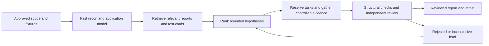

# Redhood

**By Nipun Dilshan Senevirathne · 1.0.0 · 2026-10-20**

A Claude Code skill for authorized application security research: fast recon without Amass, application modeling, targeted hypotheses, controlled testing, evidence review and retesting.

[Install and invoke](INSTALL.md) · [Skill entry point](SKILL.md) · [Current hunter audit](AUDIT.md) · [Research and provenance](RESEARCH.md) · [Executed checks](VALIDATION.md)

## How it works

Claude chooses the next useful test from observations and an explicit security invariant. The corpus supplies historical clues; the playbooks supply methods; approved local tools provide real observations. Offline helpers track shared budgets and check evidence structure. Reviewer decisions affect the report, and evidence changes invalidate prior review.

## Included

- 42 structured test cards and 15 cross-cutting control-failure families.
- 15,048 unique report IDs with preserved source metadata, plus 20 individually reviewed case notes.
- Focused web/API/auth/business-logic/browser/server/cloud/source/AI references.
- SQLite task leases, resource conflict checks, request reservations and checkpoints.
- Evidence hashes, actual capture requirements, reviewer decisions and controlled report generation.
- Optional read-only verifier agent, engagement/hypothesis/case/coverage templates.
- Static audit of Pashupatastra and primary-source agentic-system research.

The skill is an investigation workflow, not a self-contained autonomous scanning platform. External tool traffic needs real runtime constraints. It has not been benchmarked against XBOW, expert hunters or Claude baselines, and is not represented as unbeatable. See the exact limits and validation results in the linked documents.
